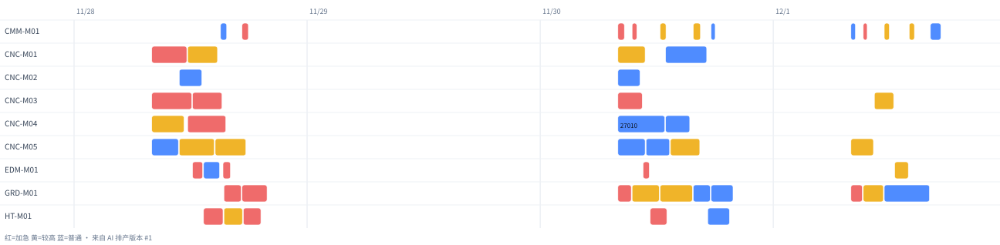
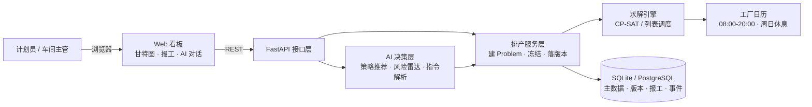

# 精密加工 AI 智能排产与进度管控系统

面向多品种、小批量精密加工车间的 **有限产能排产 + 交付风险预警 + 现场进度管控** 系统。它把“订单—工艺—设备—人员技能—班次日历”建成可求解的约束模型，用 CP-SAT 生成可执行的设备/人员级计划，并在设备故障、紧急插单、人员缺勤、批量变更时冻结已开工工序、滚动重排剩余任务。

> 定位：不是一个“大而全”的 MES，而是车间最缺的那一层——**能算、能改、能解释的智能排产与进度控制内核**。

**v1.1 生产化基线**：在原型基础上补齐了账号与 RBAC、计划“提交—审批—发布—回滚”状态机、全量审计、派工单、OEE 与 7 天产能负荷、冻结窗口（默认 120 分钟）、逾期订单自动加权、健康检查/指标端点、PostgreSQL 与容器化部署、GitHub Actions CI（lint + 20 项测试 + 镜像冒烟）。目标不是能演示，而是能在车间连续运行。



## 1. 项目背景与现场问题

精密加工车间的典型管理流程是：订单评审 → 工艺路线/工时定额 → 物料齐套 → 排产 → 派工 → 报工 → 异常处理 → 交期复盘。深入现场后最容易发现的四个断点：

| 现场现象 | 管理后果 | 系统对策 |
|---|---|---|
| 排产靠 Excel + 老师傅经验 | 插单后全表重排，计划不可信 | 约束模型 + 一键重排，冻结已开工任务 |
| 只看设备不看人 | 高精度设备开着，却没有合格操作者 | 人员技能矩阵进入排产约束 |
| 交期靠“催” | 紧急订单保护不了，普通订单被无限推后 | 优先级加权拖期目标 |
| 报工与计划两张皮 | 进度靠电话问，延期发现太晚 | 报工回写 + 风险雷达 + 偏差预警 |

## 2. 功能一览

- **有限产能排产**：设备能力/精度等级、人员技能等级、班次日历、工序先后、批量工时与装夹准备时间全部进入模型。
- **双求解引擎**：OR-Tools CP-SAT（默认）+ 列表调度启发式（兜底/预演），任一不可用时自动降级。
- **AI 策略推荐**：先做启发式“排产预演”，再按拖期率、瓶颈利用率、品种混杂度、紧急订单数选择策略与目标权重，并给出可回溯的理由。
- **交付风险雷达**：逐单给出计划完工、交期余量、风险等级与主因；按设备利用率做 Kingman 排队估计，识别瓶颈与单点技能依赖。
- **自然语言调度**： “CNC-M03 故障停机 4 小时，重新排产”“PO20261127001 加急”——规则解析为主，可选大模型兜底。
- **事件驱动重排**：故障、缺勤、插单、批量变更写入事件表，自动生成新版本并输出“哪些工序改了、改到哪里”的版本差异。
- **进度管控看板**：设备甘特图、订单进度、报工、良品/报废、任务完成率，全部来自同一份排产版本。
- **计划治理**：任何重排都先落“草稿”，经提交、审批后才能发布到车间；发布旧版本自动归档，回滚以克隆新版本实现，历史不可篡改。
- **账号与权限**：admin / planner / operator / viewer 四类角色，PBKDF2 口令散列 + JWT，登录失败锁定，全部写操作落审计表。

## 3. 系统架构



## 4. 快速开始

```bash
git clone <你的仓库地址>
cd precision-ai-aps
python -m venv .venv && source .venv/bin/activate   # Windows: .venv\Scripts\activate
pip install -r requirements.txt
uvicorn app.main:app --reload --port 8000
```

打开 <http://localhost:8000>，首次启动会自动建库、创建管理员（账号取自 `ADMIN_USERNAME`，默认 `admin`；口令取自 `ADMIN_PASSWORD`，未配置时为 `ChangeMe@2026`）、灌入 12 张演示订单并完成一次排产（约 8 秒）。接口文档在 `/docs`。

> 生产部署务必显式配置 `AUTH_REQUIRED=1`、`AUTH_SECRET`、`ADMIN_PASSWORD`，并在首次登录后修改口令。

Docker（单机 SQLite）：

```bash
docker build -t precision-ai-aps .
docker run -p 8000:8000 -e AUTH_SECRET="$(openssl rand -hex 32)" precision-ai-aps
```

Docker Compose（PostgreSQL + API，推荐生产）：

```bash
cp .env.example .env   # 填入 AUTH_SECRET / ADMIN_PASSWORD / POSTGRES_PASSWORD
docker compose up -d --build
curl -s localhost:8000/readyz
```

命令行演示（含甘特图导出）：

```bash
python scripts/demo.py --plot
```

测试：

```bash
pytest -q        # 20 项：引擎约束、API、AI、鉴权/RBAC、计划状态机、OEE/派工/健康检查
ruff check app tests scripts
```

## 5. 排产模型

**决策变量**：每道工序的开工时间 \(s_i\)，以及“设备-人员”配对选择 \(x_{i,m,w}\in\{0,1\}\)。

**硬约束**：

1. 每道工序恰好选择一组满足“设备类型 + 精度等级 + 人员技能等级”的组合；
2. 同一设备、同一人员在同一时刻只能执行一道工序（NoOverlap）；
3. 同一订单按工艺路线严格先后（\(s_{i,k+1} \ge e_{i,k}\)）；
4. 工序必须完整落在同一班次内，不跨夜、不跨休息日；
5. 设备故障、人员缺勤以不可用区间参与资源互斥；
6. 已开工/已完工工序冻结。

**目标函数**（拖期加权 + 完工跨度 + 开工时间微振荡项）：

```
min  100 · Σ_o w_o · T_o   +   2 · C_max   +   Σ_i s_i
```

其中 `T_o = max(0, C_o - d_o)` 为订单拖期，`w_o` 为优先级权重（普通 5 / 较高 15 / 紧急 40），`C_max` 为完工跨度。不同策略只改变三项权重，不改变约束，保证计划始终可执行。逾期订单按每超期 2 小时 +1 自动加权（上限 +30），避免老单被持续后推。

**班次日历**：默认 08:00–20:00、周日休息；时间在“可生产分钟”坐标下建模，输出时换算为自然时间，避免夜班与休息日造成资源空洞。

## 6. AI 能力设计

| 模块 | 输入 | 输出 | 是否依赖大模型 |
|---|---|---|---|
| 策略推荐 | 启发式预演的交期/负荷/品种特征 | 策略、目标权重、置信度、逐条理由 | 否（可选改写） |
| 风险雷达 | 当前版本计划 + 设备利用率 | 订单风险等级/主因、瓶颈排队估计、技能缺口 | 否 |
| 指令解析 | 中文调度口语 | 意图 + 订单/设备/人员/时长/交期实体 | 否（可兜底） |
| 影响解释 | 重排前后版本 | 改期/换机工序数、拖期变化、AI 摘要 | 可选 |

大模型是**增强项而非依赖项**：不配置 `LLM_API_KEY` 时，全部结论由确定性规则给出；配置后仅用于把结构化结论改写成更自然的车间语言，不参与约束求解。

## 7. 接口

| 方法 | 路径 | 说明 |
|---|---|---|
| GET | `/api/master` | 产品/工艺/设备/人员/订单主数据 |
| POST | `/api/orders` | 新建订单 |
| PATCH | `/api/orders/{code}` | 调整数量、交期、优先级 |
| POST | `/api/schedule/solve` | 排产（`strategy=auto/balanced/due_date/efficiency/changeover`） |
| GET | `/api/schedule/current` | 当前版本 + 工序任务 + 进度 |
| GET | `/api/schedule/versions` | 历史版本 |
| GET | `/api/schedule/diff?base=&target=` | 版本差异（改期/换机/增删） |
| POST | `/api/events` | 登记故障/缺勤等事件并触发重排 |
| POST | `/api/progress/report` | 工序报工（良品/报废） |
| GET | `/api/kpi` | 交期、拖期、利用率、进度 |
| GET | `/api/ai/advice` | AI 策略建议 |
| GET | `/api/ai/radar` | 交付风险雷达 |
| POST | `/api/ai/chat` | 自然语言调度指令 |
| POST | `/api/auth/login` | 登录换取 JWT（失败 5 次锁定 60 秒） |
| GET | `/api/auth/me` | 当前账号信息 |
| POST | `/api/auth/change-password` | 修改口令（初始口令强制提示） |
| GET/POST | `/api/users` | 账号列表 / 新建账号（仅 admin） |
| POST | `/api/plan/{id}/submit·approve·reject·publish·rollback` | 计划状态机：提交、审批、驳回、发布、回滚 |
| GET | `/api/plan/state` | 当前版本状态与审批轨迹 |
| GET | `/api/dispatch?day=` | 当日派工单（含换型、冻结标识） |
| GET | `/api/oee` | 设备与整体 OEE（可用率/性能率/良品率） |
| GET | `/api/capacity?days=7` | 未来产能负荷预测 |
| GET | `/api/audits` | 审计流水 |
| GET | `/healthz` `/readyz` `/metrics` | 健康检查、就绪检查、Prometheus 指标 |

示例：

```bash
curl -X POST localhost:8000/api/ai/chat -H 'Content-Type: application/json' \
  -d '{"message":"CNC-M03 故障停机 4 小时，重新排产"}'
```

## 8. 目录结构

```
precision-ai-aps/
├── app/
│   ├── main.py              # FastAPI 入口 + 鉴权/日志/健康检查/静态看板
│   ├── security.py          # PBKDF2 口令、JWT、角色依赖、初始管理员
│   ├── ops.py               # 审计、计划状态机、回滚、派工、OEE、产能
│   ├── models.py            # 主数据/版本/报工/事件
│   ├── models_ext.py        # 账号、审计、审批表
│   ├── services.py          # 建 Problem、求解、落版本、版本差异、冻结窗口
│   ├── seed.py              # 精密加工演示车间
│   ├── engine/              # 日历、领域模型、CP-SAT、启发式、指标
│   ├── ai/                  # 策略推荐、风险雷达、指令解析、LLM
│   ├── api/routes.py        # 排产/主数据/报工接口
│   ├── api/pro.py           # 鉴权、账号、计划治理、派工/OEE/审计接口
│   └── static/              # 单页看板（app.js + pro.js：登录/审批/派工视图）
├── docs/                    # 调研、现场流程、架构、AI 设计、部署
├── scripts/demo.py          # 命令行演示
└── tests/                   # 引擎/API/AI 测试
```

## 9. 与同类开源项目的关系

截至 2026-11-27，GitHub 上与本题最接近的项目分为三类（完整对比见 [docs/01-开源调研.md](docs/01-开源调研.md)）：

- **开源 MES**（[ricefishtech/industry4.0-mes](https://github.com/ricefishtech/industry4.0-mes) 519★、[metaxk-company/free-mes](https://github.com/metaxk-company/free-mes) 457★、[Mes-Open/OpenMes](https://github.com/Mes-Open/OpenMes) 209★）：强在工单、报工、追溯、OEE，但排产多为手工或简单规则；
- **APS / 排程引擎**（[frePPLe/frepple](https://github.com/frePPLe/frepple) 787★、[shuiping150/APS](https://github.com/shuiping150/APS) 158★、[PyJobShop](https://github.com/PyJobShop/PyJobShop) 181★）：算法强，但普遍缺少“人员技能矩阵 + 中文自然语言调度 + 现场事件闭环”；
- **国产开源排产**（iSuperAps，25★；JVS-APS，Gitee）：有遗传算法/配置化建模，但私有化部署与二次开发门槛较高。

本项目的取舍：**不做全量 MES**，把资源集中在“可解释的智能排产与进度管控”这一层；复用 OR-Tools 的 CP-SAT 作为求解内核，把工程价值放在数据建模、AI 决策封装、动态重排与看板上。

## 10. 落地路线

1. **主数据清洗**（1–2 周）：产品工艺路线、工时定额、设备精度等级、人员技能矩阵、班次与日历；
2. **影子运行**（2–4 周）：系统排产，计划员人工排产，双轨对比拖期率与设备利用率；
3. **切换与考核**（1 个月）：按期率、在制周期、换型次数、报工及时率纳入班组考核；
4. **扩展**：对接 ERP 订单、MES 报工、设备数采（OEE/状态），把事件从“手工登记”升级为“自动触发”。

## 11. 路线图

- [x] 计划治理：提交—审批—发布—回滚 + 全量审计（v1.1）
- [x] 派工单、OEE、7 天产能负荷、冻结窗口（v1.1）
- [x] PostgreSQL、容器化、CI 与健康检查（v1.1）
- [ ] 换型时间序列相关（sequence-dependent setup）与成组技术
- [ ] 订单拆批、替代设备/替代工艺与物料齐套约束
- [ ] 扫码报工与设备数采（OPC UA / MQTT），OEE 改用实际节拍
- [ ] 多车间/外协联合排产与多工厂产能协同
- [ ] 与 ERPNext / 用友 / 金蝶订单与工单接口

## 12. 许可

MIT License，见 [LICENSE](LICENSE)。
